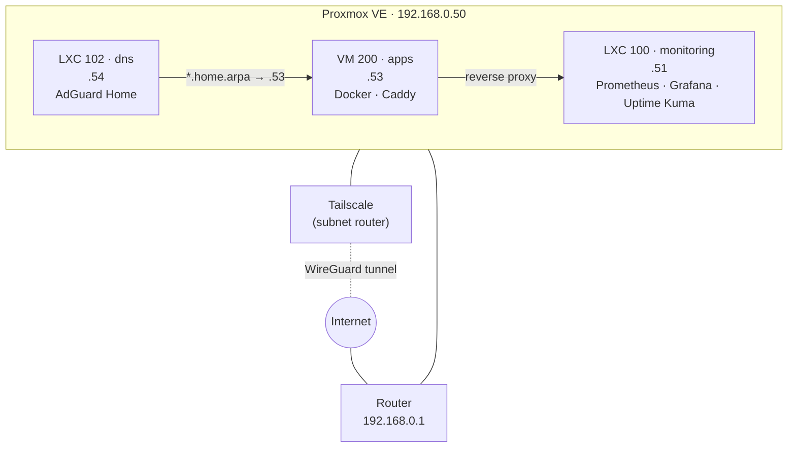

# Homelab

A single-node home server for hosting personal projects and practicing infrastructure operations with cloud-equivalent building blocks: virtualization, networking, DNS, reverse proxying, VPN-based remote access and monitoring.

> Status: **work in progress**. This repo documents what is running today; what's next is in the [roadmap](docs/roadmap.md).

## Architecture



How a request flows on the local network:

```
Browser → AdGuard (what IP is grafana.home.arpa?) → Caddy on .53 (which service?) → Grafana on .51:3000
```

**No ports are open on the router.** Remote access goes exclusively through Tailscale.

## Hardware

| Component | Details |
|---|---|
| Machine | Beelink SER3 mini PC |
| CPU | AMD Ryzen 5 3500U · 4 cores / 8 threads · Radeon Vega 8 iGPU |
| RAM | 16 GB DDR4 (~14 GiB usable; the rest is reserved by the iGPU) |
| Storage | 256 GB NVMe |
| Network | Realtek Gigabit Ethernet, wired to the router |

## Inventory

| ID | Type | Name | IP | Resources | Role |
|---|---|---|---|---|---|
| — | Host | `pve` | 192.168.0.50 | — | Proxmox VE 9, node-exporter, Tailscale |
| 100 | LXC | `monitoring` | 192.168.0.51 | 2 vCPU · 2 GB · 16 GB | Prometheus, Grafana, Uptime Kuma (Docker) |
| 200 | VM | `apps` | 192.168.0.53 | 4 vCPU · 6 GB (2 GB ballooning floor) · 64 GB | Ubuntu Server 26.04, Docker, Caddy |
| 102 | LXC | `dns` | 192.168.0.54 | 1 vCPU · 512 MB · 4 GB | AdGuard Home |

Addressing plan: the router's DHCP hands out `.100–.199`; infrastructure uses static IPs starting at `.50`. See [networking](docs/02-networking.md).

## Services

| Service | Internal URL | Runs on |
|---|---|---|
| Proxmox | `https://pve.home.arpa:8006` | pve |
| Grafana | `http://grafana.home.arpa` | monitoring (via Caddy) |
| Uptime Kuma | `http://kuma.home.arpa` | monitoring (via Caddy) |
| Prometheus | `http://192.168.0.51:9090` | monitoring |
| AdGuard Home | `http://192.168.0.54` | dns |

## Documentation

1. [Hypervisor: why Proxmox and how it's set up](docs/01-proxmox.md)
2. [Networking: static IPs, DHCP and bridges](docs/02-networking.md)
3. [Remote access with Tailscale](docs/03-tailscale.md)
4. [Monitoring: Prometheus, Grafana and Uptime Kuma](docs/04-monitoring.md)
5. [Application VM and SSH](docs/05-apps-vm.md)
6. [Local DNS with AdGuard Home](docs/06-dns.md)
7. [Reverse proxy with Caddy](docs/07-reverse-proxy.md)
8. [Troubleshooting: real issues and how they were solved](docs/troubleshooting.md)
9. [Design decisions](docs/decisions.md)
10. [Roadmap](docs/roadmap.md)

## Versioned configuration

| Path | Deployed to |
|---|---|
| [`monitoring/`](monitoring) | `/opt/monitoring` on the `monitoring` LXC |
| [`apps/proxy/`](apps/proxy) | `~/infra/proxy` on the `apps` VM |

This repository contains no passwords, tokens or keys.

## Stack

Proxmox VE · KVM/QEMU · LXC · Debian 13 · Ubuntu Server 26.04 LTS · Docker / Compose · Prometheus · node-exporter · Grafana · Uptime Kuma · Tailscale (WireGuard) · AdGuard Home · Caddy
